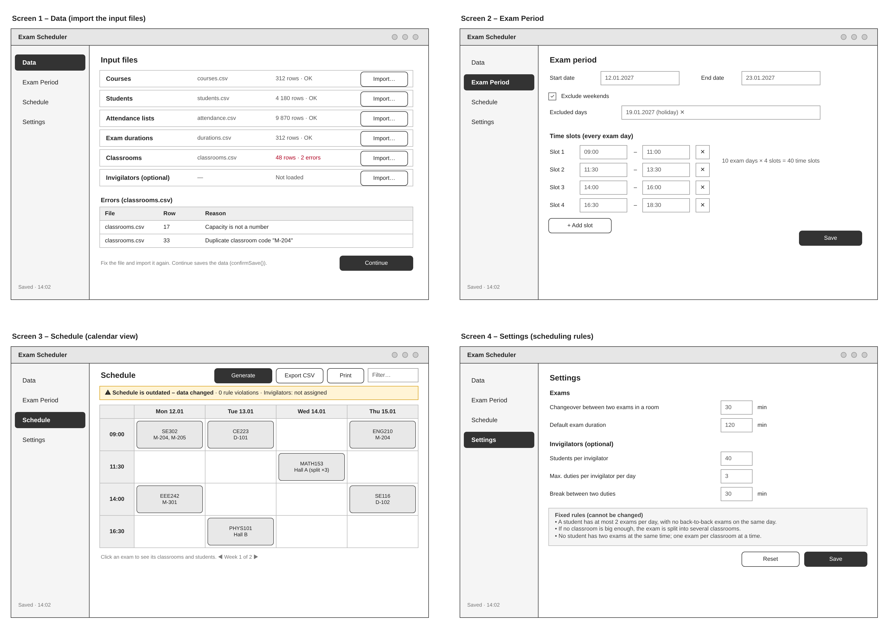
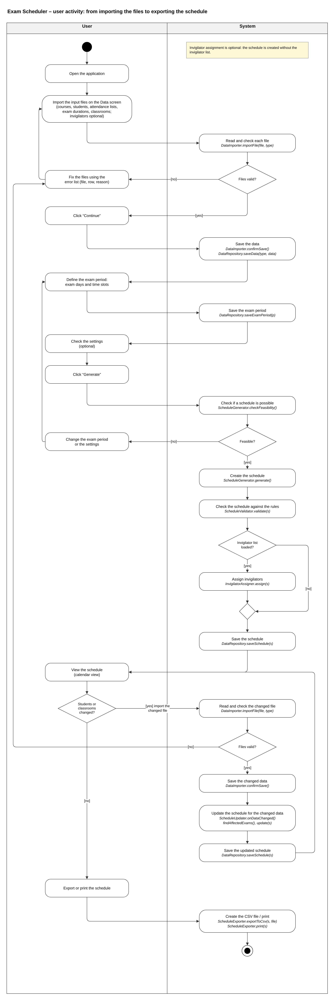

# Eljan - design notes

## UI screens (`ui-screens.png`)

The application has one main window with a menu on the left and four main screens: Data, Exam Period, Schedule and Settings. On the Data screen the user imports the course, student, attendance list, exam duration and classroom files, and optionally the invigilator file; each Import button calls `DataImporter.importFile(file, type)`, and the screen shows how many rows were read and lists each error with its file, row and reason (FR 1, 3, 6, 23, 24). The Continue button calls confirmSave(). On the Exam Period screen the user sets the start and end dates, the excluded days and the time slots of each exam day, and Save calls `DataRepository.saveExamPeriod(p)` (FR 4). The Schedule screen creates the schedule with the Generate button and shows it as a calendar of days and time slots, where each exam shows its course and classrooms (FR 7, 19, 28, 29). A status bar above the calendar shows the number of rule violations, whether invigilators were assigned, and the warning "Schedule is outdated - data changed" when the input data changes after the schedule is created (FR 14-16, 26, 40, 42). The Export CSV and Print buttons call `ScheduleExporter.exportToCsv(s, file)` and `ScheduleExporter.print(s)` (FR 20, 21, 54). On the Settings screen the user can change the changeover time between two exams in a room (30 min), the default exam duration, the number of students per invigilator (40), the maximum duties per invigilator per day (3) and the break between two duties (30 min); the rules "at most 2 exams per day", "no back-to-back exams" and "split an exam into several classrooms" are fixed and only shown as text.

User interface classes (to be added to `docs/class-list.md`):

| Class | Responsibility | Calls |
|---|---|---|
| `MainController` | Controls the main window and the menu; opens the screens | `DataRepository.loadCurrentData(type)`, `loadExamPeriod()`, `loadExamSchedule()` |
| `DataController` | Imports the input files, shows the import errors and saves the data | `DataImporter.importFile(file, type)`, `DataImporter.confirmSave()` |
| `ExamPeriodController` | Sets the exam days and time slots | `DataRepository.saveExamPeriod(p)` |
| `ScheduleController` | Generates, shows, exports and prints the schedule | `ScheduleGenerator.checkFeasibility()`, `generate()`, `ScheduleValidator.validate(s)`, `InvigilatorAssigner.assign(s)`, `ScheduleExporter.exportToCsv(s, file)`, `print(s)` |
| `SettingsController` | Sets the changeable scheduling and invigilator values | - |

## User activity diagram (`user-activity.drawio`, `user-activity.png`)

The activity diagram shows the steps of the user and the system from opening the application to exporting the schedule. The user imports the input files, and `DataImporter.importFile(file, type)` reads and checks each file; if a file has errors, the user fixes it and imports it again (FR 1, 3, 6, 23, 24). When the files are valid and the user clicks Continue, `DataImporter.confirmSave()` saves the data with `DataRepository.saveData(type, data)` (FR 27), and the exam period the user defines is saved with `DataRepository.saveExamPeriod(p)` (FR 4). After the user clicks Generate, `ScheduleGenerator.checkFeasibility()` checks if a schedule is possible; if not, the user changes the exam period or the settings and tries again. Otherwise `ScheduleGenerator.generate()` creates the schedule and `ScheduleValidator.validate(s)` checks it against the rules (FR 7, 8, 28-39, 40). Invigilators are assigned by `InvigilatorAssigner.assign(s)` only if an invigilator list was loaded, and the schedule is then saved with `DataRepository.saveSchedule(s)` (FR 16, 43-49). If the student list or the classrooms change, `DataImporter.importFile(file, type)` reads and checks the changed file; if it has errors, the user fixes it as before, otherwise `DataImporter.confirmSave()` saves it. Then `ScheduleUpdater.onDataChanged()`, `findAffectedExams()` and `update(s)` update the schedule, and `DataRepository.saveSchedule(s)` saves it before it is shown again (FR 26, 27, 42). Finally, the user exports or prints the schedule with `ScheduleExporter.exportToCsv(s, file)` or `ScheduleExporter.print(s)` (FR 20, 21, 54).
